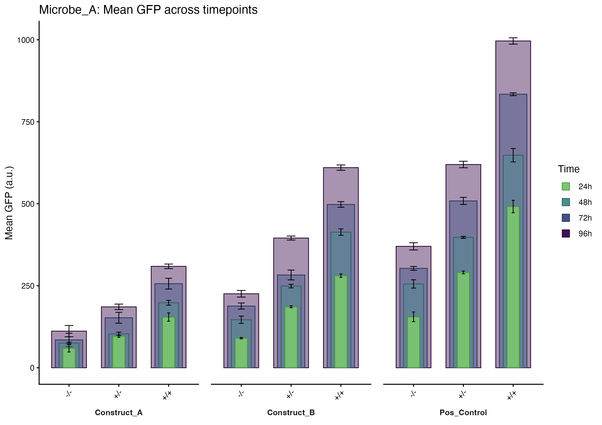
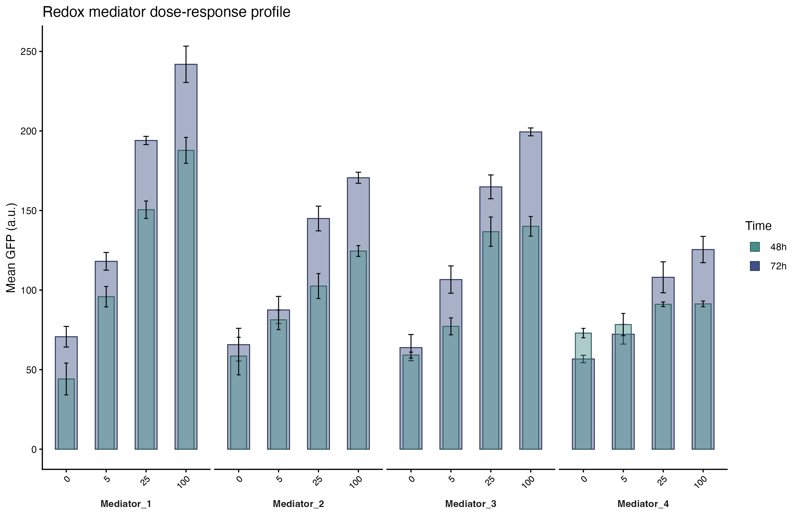

# FlowJo Time-Course and Dose-Response Cytometry Analysis (R)

[](https://github.com/yijiulu/flowjo-r-pipeline/actions/workflows/ci.yml)
[](LICENSE)

Modular R pipeline for ingesting FlowJo exported summary tables, joining plate-layout metadata, computing replicate statistics with error-propagated baseline subtraction, and generating publication-ready `ggplot2` figures for microbial fluorescence assays.

> **Data note**: Unpublished experimental measurements and internal construct identifiers are excluded from this repository. A self-contained synthetic data generator is provided under `examples/` so the entire workflow can be verified out of the box.

## Repository Structure

```text
.
├── .github/workflows/ci.yml      # Automated R testthat & synthetic demo CI
├── DESCRIPTION                   # Standard R dependency declaration
├── R/
│   ├── io.R                      # FlowJo CSV ingestion, well validation, metadata joins
│   ├── stats.R                   # Unbiased sample SEM & baseline-corrected error propagation
│   └── plotting.R                # Layered multi-timepoint & dose-response ggplot2 builders
├── docs/
│   ├── demo_timecourse.png       # Example output from synthetic multi-timepoint demo
│   └── demo_dose_response.png    # Example output from synthetic dose-response demo
├── scripts/
│   ├── analyze_timecourse.R      # CLI entrypoint for time-course and baseline-corrected assays
│   └── analyze_dose_response.R   # CLI entrypoint for mediator dose-response screening
├── examples/
│   └── generate_synthetic_demo.R # Generates synthetic FlowJo & metadata CSVs and runs both CLIs
├── tests/
│   └── testthat/
│       └── test_pipeline.R       # Unit tests for ingestion, statistics, and plotting
├── LICENSE
└── README.md
```

## Example Outputs (Synthetic Demo)

Generated out of the box via `Rscript examples/generate_synthetic_demo.R`:





## Key Features

- **Cross-platform FlowJo parsing**: Normalises both POSIX (`/`) and Windows (`\`) `.fcs` paths exported by FlowJo, filters valid 96-well coordinates (`A01`–`H12`), checks for duplicate `Sample_ID` entries, and enforces strict `one-to-one` metadata joins on `(Run, Well)`.
- **Unbiased uncertainty quantification**: Computes biological replicate mean, sample standard deviation ($n - 1$ denominator), standard error of the mean ($\mathrm{SEM} = s / \sqrt{n}$), and quadrature-propagated uncertainty for baseline-subtracted responses ($\mathrm{SE}_{\mathrm{net}} = \sqrt{\mathrm{SE}_{\mathrm{cond}}^2 + \mathrm{SE}_{\mathrm{base}}^2}$).
- **Layered multi-timepoint visualisation**: Plots nested timepoints from latest (widest, semi-transparent) to earliest (narrowest, opaque) with matched error bars and configurable display labels via external CSV maps.

## Requirements

- R `>= 4.1` (uses native pipe `|>`)
- CRAN packages: `dplyr`, `tidyr`, `ggplot2`, `scales`
- For tests: `testthat`

```r
install.packages(c("dplyr", "tidyr", "ggplot2", "scales", "testthat"))
# Or install directly from DESCRIPTION:
# remotes::install_deps(dependencies = TRUE)
```

## Quick Start (Synthetic Demo)

Generate synthetic FlowJo export tables and run both analysis CLIs end to end:

```bash
Rscript examples/generate_synthetic_demo.R --outdir outputs/demo
```

Or run the CLI scripts directly on your own FlowJo exports:

```bash
# Multi-timepoint condition comparison with baseline subtraction
Rscript scripts/analyze_timecourse.R \
  --flowjo path/to/flowjo_export.csv \
  --metadata path/to/plate_metadata.csv \
  --species "Species_A" \
  --baseline "-/-" \
  --times "96,72,48,24" \
  --outdir outputs/timecourse

# Mediator dose-response screen
Rscript scripts/analyze_dose_response.R \
  --flowjo path/to/dose_flowjo_export.csv \
  --metadata path/to/dose_metadata.csv \
  --times "72,48" \
  --outdir outputs/dose_response
```

### Expected Input Schemas

1. **FlowJo table CSV**: Contains file path column (`X` or `File`), well coordinate (`X.WELLID` or `Well`), gated cell count (`...Count`), and median fluorescence intensity (`...Median...GRN...` or `Median_GFP`). Explicit column names can also be supplied via `--count-col` and `--fluor-col`.
2. **Metadata CSV**: Contains `Run`, `Well`, `Species`, `Strain`, `Time_h`, `Condition`, and (for dose-response assays) `Concentration`.

## Running Tests

```bash
Rscript -e "testthat::test_dir('tests/testthat')"
```

## Licence

Released under the [MIT License](LICENSE).
